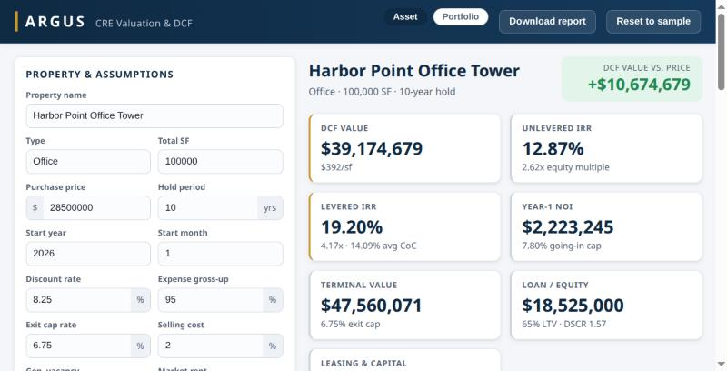
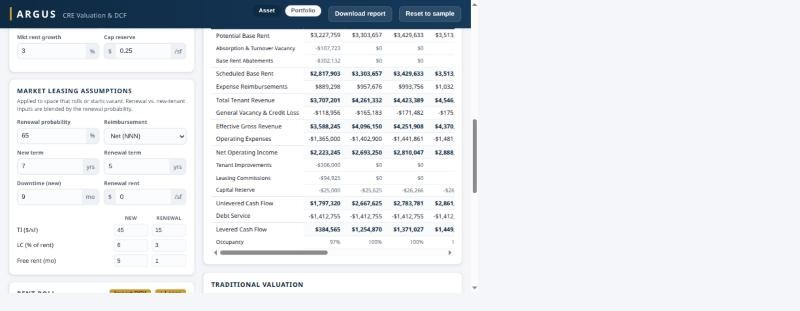
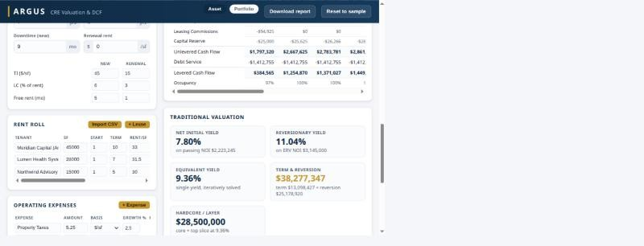
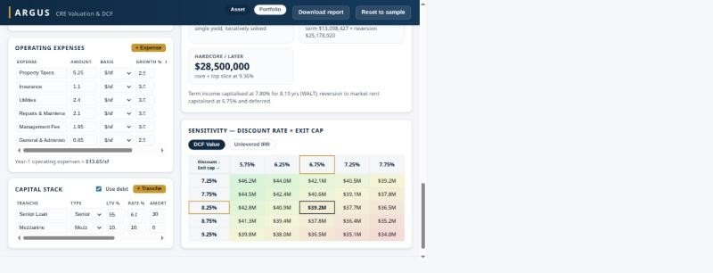
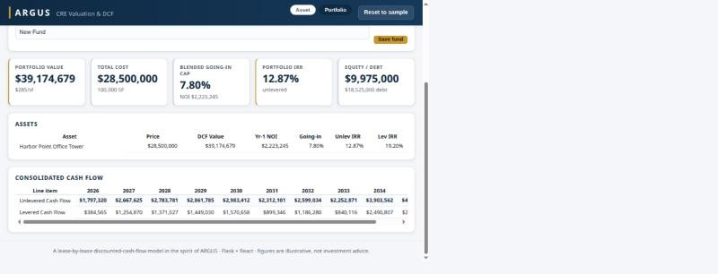

# ARGUS — CRE Valuation & DCF

A working re-creation of the core of **ARGUS**: a lease-by-lease commercial
real-estate **discounted-cash-flow (DCF) valuation** tool. Enter a property, its
rent roll, operating expenses and (optionally) debt; the engine projects a
daily cash flow over the hold period and values the asset with a direct-cap
terminal value and a full DCF — returning NOI, cap rates, DCF value, NPV,
unlevered/levered IRR, equity multiples and cash-on-cash.

> Built as **Python / Flask** (financial engine + REST API) and **React / Vite**
> (interactive UI). Figures are illustrative — not investment advice.

 



## Screenshots

**Operating proforma** — the full ARGUS cash flow in financial-year order
(Potential Base Rent → … → Levered Cash Flow), with the market leasing
assumptions on the left. Toggle Annual / Monthly.



**Traditional valuation** — Net Initial, Reversionary and Equivalent yields, a
Term & Reversion and a Hardcore/layer value, beside the editable rent roll
(with CSV import).



**Sensitivity & capital stack** — a discount-rate × exit-cap heatmap of DCF
value (or IRR), with the multi-tranche capital stack and operating expenses.



**Portfolio / fund** — consolidate several deals into blended value, cap rate,
equity/debt and a portfolio-level IRR, with a consolidated cash flow.



---

## What it models

Modeled after the real ARGUS Enterprise workflow (studied from Altus's feature
documentation and market-leasing references):

- **Calendar-daily engine.** Like ARGUS, every line is accrued on the **actual
  calendar** (real dates, leap years) and rolled up to months and true 12-month
  financial years — so fiscal-year starts, mid-period commencements, fractional
  downtime, free-rent burn-off and the day a TI/LC check is cut are all exact.
  The UI shows the annual roll-up or the full monthly cash flow.
- **Rent roll** — in-place leases with suite SF, start year/month, term, base
  rent $/SF, a per-lease reimbursement method, optional upfront TI/LC and
  optional **percentage rent** (retail).
- **Rent reviews** — fixed escalations, **CPI** (a flat rate *or* a published
  **index series**), or an explicit **stepped** rent schedule, chosen per lease.
- **Market Leasing Assumptions (MLAs)** — the defining ARGUS feature. When a
  lease rolls (or space starts vacant), it re-leases on a **renewal-probability-
  weighted blend** of "renew" and "new tenant" outcomes, each with its own
  market rent, **term, downtime, free rent, tenant improvements (TI) and leasing
  commissions (LC)**. Space re-leases recursively for the length of the analysis.
- **Absorption & turnover vacancy** — downtime on rollover is an explicit line,
  and general vacancy is netted against it (ARGUS convention) to avoid double
  counting.
- **Reimbursement structures** — each lease recovers operating expenses as
  **Net** (pro-rata share), **Base-Year Stop** (increase over the lease's own
  first twelve months) or **Gross** (none), with optional **occupancy
  gross-up**, an **annual cap** on recoverable-expense growth, an **expense stop
  ($/SF)**, an **admin fee**, and recoverable / non-recoverable and fixed /
  variable expense pools.
- **Leasing & capital costs below NOI** — TI, LC (as a **% of rent or $/SF**)
  and $/SF capital reserves, exactly as in an ARGUS cash flow.
- **DCF valuation** — going-in cap, terminal value from forward NOI at an exit
  cap, selling costs, NPV vs. price, unlevered IRR / equity multiple.
- **Traditional valuation** — **Net Initial Yield**, **Reversionary Yield**, an
  iteratively-solved **Equivalent Yield**, a **Term & Reversion** capitalisation,
  and the **Hardcore / layer** method.
- **Financing** — a full **capital stack**: multiple **tranches** (senior /
  mezzanine), each interest-only or amortizing, with **participating** loans
  (a lender share of the reversion *and/or* of annual cash flow); DSCR, levered
  IRR, equity multiple, CoC.
- **Portfolio / fund consolidation** — roll several deals into blended value,
  cap rate, equity/debt and a portfolio-level IRR, optionally with a
  **cross-collateralised fund-level loan**; save and reload **named funds**.
- **Operations** — **CSV rent-roll import**, an **.xlsx report pack** (summary,
  annual & monthly cash flow, rent roll, sensitivity, traditional valuation),
  and **versioned** saved scenarios (persisted to disk).
- **Sensitivity analysis** — a discount-rate × exit-cap grid of DCF value and
  unlevered IRR (ARGUS "what-if").

The proforma is laid out in ARGUS Enterprise order: Potential Base Rent →
Absorption & Turnover Vacancy → Base Rent Abatements → Scheduled Base Rent →
Expense Reimbursements → Total Tenant Revenue → General Vacancy → Effective
Gross Revenue → Operating Expenses → NOI → TI / LC / Capital → Unlevered Cash
Flow → Debt Service → Levered Cash Flow.

The included sample is a 100,000 SF, $28.5M office deal (*Harbor Point Office
Tower*): an anchor on fixed bumps, a tenant on CPI with a base-year stop and
admin fee, a tenant on a stepped rent schedule, plus 12,000 SF of day-one
vacancy that leases up under the MLA profile — financed with a senior loan and a
participating mezzanine tranche.

## Project layout

```
argussoftware/
├── backend/            Flask API + valuation engine
│   ├── engine.py       Pure-Python calendar-daily engine (no numpy) — the core
│   ├── report.py       .xlsx report-pack builder (openpyxl)
│   ├── app.py          REST API
│   ├── requirements.txt
│   └── tests/          test_engine.py, test_app.py
├── frontend/           React + Vite single-page app
│   └── src/
│       ├── App.jsx                 state, data fetching, layout
│       ├── api.js / format.js
│       └── components/             assumptions, market leasing, rent roll,
│                                   expenses, capital stack, results, chart,
│                                   proforma, sensitivity, traditional valuation,
│                                   portfolio
└── README.md
```

## Running it

Two processes: the Flask API on **:5001** and the Vite dev server on **:5173**
(Vite proxies `/api` to Flask, so just open the frontend).

### 1. Backend

```bash
cd backend
python3 -m venv .venv
source .venv/bin/activate
pip install -r requirements.txt
flask --app app run --port 5001
```

### 2. Frontend (in a second terminal)

```bash
cd frontend
npm install
npm run dev
```

Then open **http://localhost:5173**. Edit any assumption, lease or expense and the
valuation re-runs automatically.

### Tests

```bash
cd backend && source .venv/bin/activate && pytest
```

## API

| Method | Path                     | Purpose                              |
|-------:|--------------------------|--------------------------------------|
| GET    | `/api/health`            | Liveness check                       |
| GET    | `/api/sample`            | Default sample scenario              |
| POST   | `/api/analyze`           | Run a valuation on a posted scenario |
| POST   | `/api/report`            | Download an `.xlsx` report pack      |
| POST   | `/api/import/rentroll`   | Parse a CSV rent roll into leases    |
| POST   | `/api/portfolio`         | Consolidate deals (+ optional fund debt) |
| GET/POST/DELETE | `/api/portfolios[/<id>]` | List / save / load / delete named funds |
| GET    | `/api/scenarios`         | List saved scenarios (persisted)     |
| POST   | `/api/scenarios`         | Save a scenario (creates version 1)  |
| GET/PUT/DELETE | `/api/scenarios/<id>` | Fetch / update (new version) / delete |
| GET    | `/api/scenarios/<id>/versions` | List a scenario's version history |

**Analyze example:**

```bash
curl -s localhost:5001/api/sample \
  | curl -s -X POST -H 'Content-Type: application/json' \
         --data-binary @- localhost:5001/api/analyze
```

Returns the property, echoed assumptions, a per-year `cash_flow` proforma and a
`metrics` block (DCF value, cap rates, IRRs, equity multiples, debt metrics).

## Modeling notes

The engine computes the way ARGUS does — on the **calendar day**, lease-by-lease,
with market leasing assumptions, fixed/CPI/stepped rent reviews, reimbursement
structures (caps, stops, gross-up, admin fees), percentage rent, multi-tranche
participating debt (reversion *and* cash-flow), all five valuation methods, and
portfolio consolidation with cross-collateralised fund debt. Scenarios are
versioned, importable from CSV, and exportable as an `.xlsx` report pack.

Two items from the earlier "remaining" list are deliberately left out because
they are not meaningful here: **sub-daily** accrual (the calendar day is ARGUS's
own finest granularity), and real **multi-user authentication / accounts** (this
is a single-user local tool — the collaborative piece, named funds, is
implemented instead). The engine (`backend/engine.py`) is small, documented and
unit-tested (**28 tests**), so extending it further is straightforward.
